# Hi, I'm Fildza!

## About Me

I build web interfaces, write the APIs behind them, and work with data from sensors and public datasets. I enjoy the part where those pieces meet, whether that means turning a stream of readings into a chart or making sure two requests can’t reserve the same slot.

## Focus Areas

- **Web interfaces.** I use maps for questions about place and charts for questions about change over time.
- **Backend engineering.** I model booking and payment flows and test what happens when requests overlap, a webhook arrives, or a user lacks permission.
- **IoT and automation.** I connect sensor readings to live dashboards through MQTT and use n8n to send notifications.
- **Data analysis.** I use Python notebooks and SQL to explore datasets. My machine learning work includes classifying sentiment in Indonesian-language comments.

## Technical Toolkit

| Area | Tools I use |
| --- | --- |
| Web | TypeScript, JavaScript, React, Next.js, Tailwind CSS |
| Maps and charts | Leaflet, Recharts, Chart.js |
| APIs and data access | Node.js, Express, Prisma, Zod |
| Data exploration | Python, Jupyter, SQL |
| Messaging and automation | MQTT, Mosquitto, n8n |
| Testing and delivery | Vitest, Supertest, Docker Compose, GitHub Actions |

## Get in Touch

 &nbsp; 

## GitHub Activity

